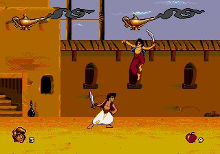
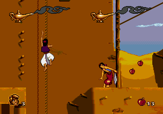
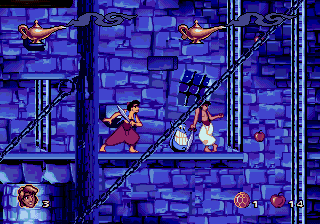

# Aladdin Co-op

## Portable EXE: choose a ROM and play

[Download the portable Windows x64 ZIP](https://github.com/Linn1024/coop-releases/releases/download/windows-2026-10-27/Aladdin-Coop-Portable-Windows-x64.zip).

1. Extract the entire ZIP and open **Aladdin-Coop.exe**. Keep its `engine` folder beside it.
2. On first run, choose your own original USA ROM. Its filename and folder can
   be anything; the launcher verifies the contents and remembers the location.
3. Next time, open the same EXE to play. The ROM is read from its original
   location and is not copied into the download.

Use **Settings > Choose ROM** to select a different location, **Settings >
Screen size** for 1x/2x/3x/4x windows or fullscreen, and **Settings > Controls**
(or **F2**) to rebind either player's keyboard and Xbox-compatible gamepad.
**F11** or **Alt+Enter** toggles fullscreen. Resizing the window and changing
controls are remembered for the next launch.

Settings and standalone saves live in `%LOCALAPPDATA%\Linn1024Coop\AladdinCoop`.
**Settings > Open saves and settings folder** opens that folder. Existing local
standalone saves/controls are copied there once when upgrading without replacing
newer user files. If the selected ROM is moved or deleted, choose it again.
These settings apply to the standalone EXE; BizHawk retains its own settings.

In **Settings > Controls**, **Controller** means an Xbox-compatible game controller.
Every keyboard/controller binding has a **Clear** button. Save shortcuts can also
be changed or cleared there: **F5 quicksave**, **F8 quickload**, **F6 next slot**,
and **F7 previous slot** by default. There are **10 slots (1-10)**; next/previous
wrap at the ends. The selected slot is remembered. The **Saves** menu selects a
slot or saves/loads directly, and the controls window has Save now/Load now buttons.

Explore Agrabah with a friend! Play Aladdin's adventure together, from the opening level to the final showdown.

## Watch the gameplay

[Aladdin on Sega Genesis... Now With 2 Players!](https://youtu.be/08rOHvWDWrc)

## Screenshots

## Play together

- Two players, each with their own movement, sword, apples, and health bar.
- Play through the story, boss fights, and Abu bonus rooms together.
- P1 wears purple and white; P2 wears blue and red.
- Share lives and stay together as the camera follows both players.
- Rejoin your partner when you get separated, with Genie sparkles and sound.
- Ride your own magic carpet during the escape!

In the title-screen **Options**, choose what happens when a player dies:

- **PARTNER:** the fallen player returns beside their surviving partner.
- **CHECKPOINT:** both players return to the checkpoint.

Either choice costs one shared life. If both players fall, you return to the checkpoint.

## Controls

| Action | Player one | Player two | Xbox-style controller |
| --- | --- | --- | --- |
| Move / climb / crouch | WASD | Arrow keys | D-pad / left stick |
| Sword | F | J | X |
| Apple | G | K | B |
| Jump | Space | L | A |
| Rejoin partner (Genesis X) | X | O | Y |
| Pause | Enter | Enter | Start |

These are the default standalone controls; in BizHawk, configure both players under **Config > Controllers**.

## Getting started

Play on Windows using the standalone game or BizHawk. You'll need your own USA version of Aladdin; the game ROM isn't included.

**[Download Aladdin-Coop-Windows-Setup.zip](https://github.com/Linn1024/aladdin-coop/releases/download/v0.1.0/Aladdin-Coop-Windows-Setup.zip)**

Extract the entire ZIP, double-click **Install.cmd**, and select your original Aladdin USA ROM. Setup checks the ROM and creates desktop and Start menu shortcuts. No administrator access or separate emulator is needed. See [installer instructions](installer/START-HERE.txt) for controls, updates, and removal.

Use the download above to install and play. GitHub's **Code > Download ZIP** contains source code, not the built installer. [Release notes and checksum](https://github.com/Linn1024/aladdin-coop/releases/tag/v0.1.0) are also available.

To build the installer ZIP or game yourself, use the [developer guide](DEVELOPMENT.md). For BizHawk, see [setup instructions](bizhawk/README.md).

## Found a bug?

The co-op campaign is still being playtested. [Report an issue](https://github.com/Linn1024/aladdin-coop/issues) with the level, what happened, and a screenshot if possible. Keep a save near the problem so it can be reproduced.
